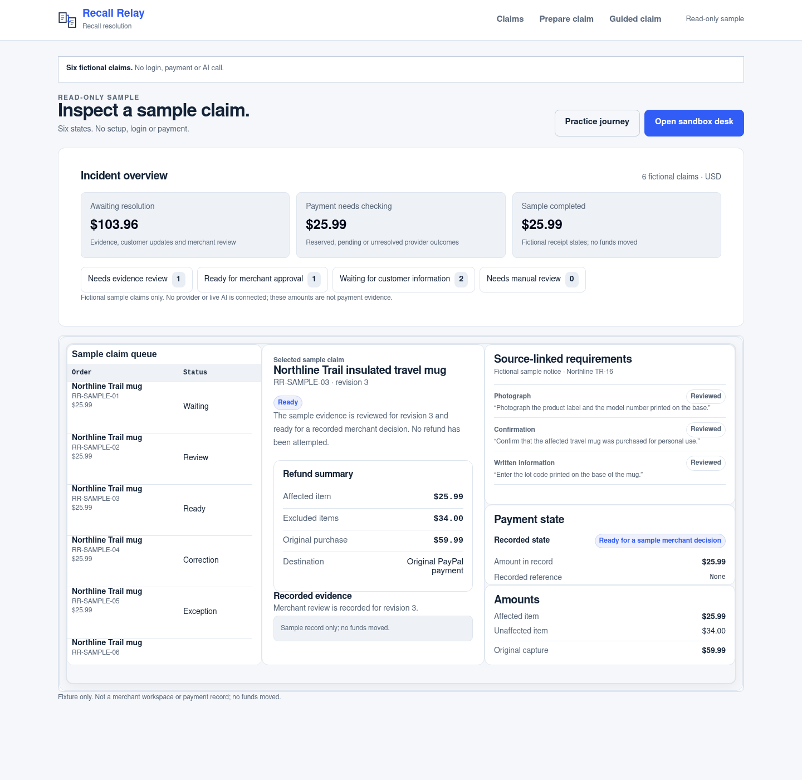
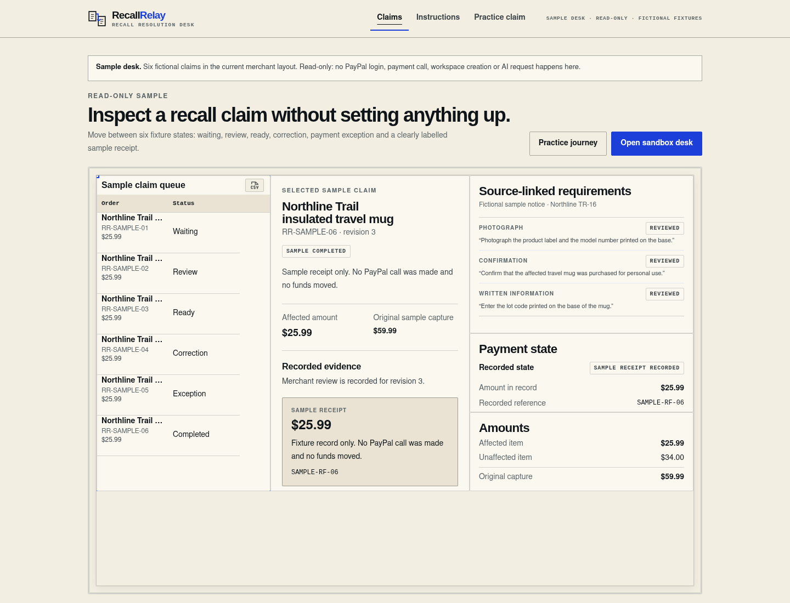
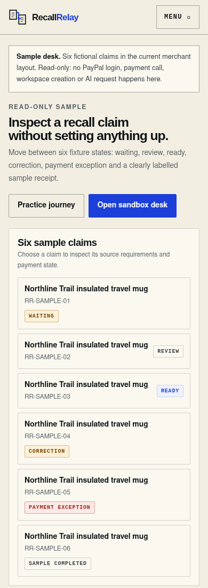

# Recall Relay

Turn a reviewed recall notice into a customer claim form, collect its required
evidence, and resolve an eligible refund to the original PayPal payment.
The customer returns to the same private page for a confirmed receipt.

This build uses fictional merchandise and **PayPal Sandbox**. Public CPSC
notices supply scenarios; importing one does not create a manufacturer
relationship or register a real recall claim.

## Read-only sample desk

`/sample` is the fastest way to inspect the product. It shows six fictional
claims across waiting, review, ready, correction, payment-exception and
sample-receipt states in the current merchant layout. It does not create a
workspace or cookie, call PayPal, or consume an AI request. The source-linked
requirement, payment-state and amount widgets are AG Studio custom widgets fed
by the displayed fixture; selecting a queue row updates them. The receipt is
labelled as an invented sample and no funds move.







## Importing existing purchases

An authenticated merchant desk has an **Import existing purchases** action. Choose
a version-1 JSON ledger or paste the same JSON; the browser sends the declaration
to `POST /api/merchant/import-preview` and shows the server's answer. The preview
classifies each declared line as affected, unaffected or manual against the
published product and lot, and separates the declared candidate value from a
verified refundable amount and confirmed refunds (both unknown here). Explicit
zero stays zero and an unknown amount stays unknown.

Nothing is persisted and no provider is contacted. Imported rows carry no
allocation and no refund or approval action; duplicate capture declarations stay
manual until reconciled. See the
[import preview contract](docs/ledger-import-contract.md).

## Recall-to-purchase reconciliation

The desk's **Reconcile recall purchases** action separates recall scope
(affected, excluded, unknown) from claim readiness. Use a version-1 merchant
ledger or load historical saved workspace purchases. An exact capture, SKU,
lot, item allocation and instruction-version match can open an existing claim.
A capture ID alone never establishes a line allocation. Duplicates and mismatched
allocations stay blocked; missing product/lot information stays explicit.

For a missing lot, record a labelled planning assumption and reconcile again.
This creates a new immutable plan, changes no customer evidence and cannot
override a recorded out-of-scope lot. Up to 20 plans are retained per workspace
and can be reloaded/exported. Historical purchase amounts show their recorded
time and snapshot ID, never a current refundable balance.

Linked Studio panels show scope, readiness, declared amounts and saved evidence;
ordinary controls cover smaller screens. Read-only AI guidance interprets the
saved public source clauses with exact citations. Ledger records, customer
answers and capture identifiers are not sent to the model. Guidance does not
change scope or approve a payment. This increment supports the published single
SKU/lot scope, not arbitrary natural-language policy execution or automatic
classification of every recall remedy.

## Provisioned purchases and AI advisory

The desk always shows a compact **Provisioned purchases** section so the
workspace reference and provisioning context remain available. When a
server-side operator grant exists for the authenticated workspace, the section
lists it and the browser sends only the grant id to
`POST /api/merchant/bind-purchase`; it cannot supply a capture id, amount or
verification flag. With no grant, **Create sandbox purchase** is the
ordinary primary action. The server checks the provider order and capture and
creates the ordinary claim view. Capture ownership is durable and
capture-global; transfers and rebinding stay manual in this release.

The connected desk keeps the deterministic **Recorded review brief** separate
from the **AI advisory** panel. The advisory is requested for one case and
revision, shows cited source clauses with actor, timing, condition and recorded
gaps, and is labelled model-assisted rather than recorded fact. A stale revision
hides the result. The Claim guide exposes the same three read-only reads
(`get_case_brief`, `get_source_requirements`, `get_evidence_gaps`); none can
approve, refund or change evidence.

## Browser hosting

The Cloudflare build runs AI on the server and works in a normal browser;
visitors do not need a Mac or a local model. The hosted interface is at
[recall-relay.dolepee.com](https://recall-relay.dolepee.com); the read-only
sample is at
[recall-relay.dolepee.com/sample](https://recall-relay.dolepee.com/sample).
Backend configuration is in `cloud/`; Pages uses the root `wrangler.jsonc`.

The site root (`/`) serves the reviewed landing page in `public/landing.html`;
the merchant desk is at `/desk`, claim instructions at `/setup`, the private
customer claim at `/claim`, the simulated practice journey at `/practice` and
the read-only sample desk at `/sample`. The landing source is not served
directly at `/landing.html`.

Routing differs by environment, deliberately:

- `npm run dev` (Vite middleware) serves `index.html` for every path, so all app
  routes, including `/training`, work there.
- `npm run build` followed by `npm start` serves the built `dist/`: `/` returns
  `landing.html`, `/desk`, `/setup`, `/claim`, `/practice`, `/sample` and
  `/training` return the app document, and every other path returns 404.
- Cloudflare Pages (`cloud/pages-worker.mjs`) returns `landing.html` for `/`, the
  app document for `/desk`, `/setup`, `/claim`, `/practice` and `/sample`, and
  404 for everything else.
  The training workspace is local-only and is not exposed on the hosted site.

Each browser receives an isolated sandbox merchant workspace in an HttpOnly
cookie. Keep that browser session: clearing its cookie loses access to its desk.
A private customer link grants access to one claim, not to merchant actions.
This is a sandbox evaluation service, not production merchant onboarding.
Use disposable test images and fictional responses only.

For your own Cloudflare account, first verify its plan and current quotas.
The supplied application caps new workspaces at 200/day, AI calls at 80/day
globally and 20/day per workspace, and purchases at six per workspace. These
caps do not replace the provider's account-wide limits or billing settings.
The backend uses SQLite Durable Objects and Workers AI; the Pages frontend
reaches it through a service binding. Its public Worker hostname is disabled.

```sh
npm ci
npm test
npm run test:cloud
npm run build:cloud
npx wrangler deploy --config cloud/wrangler.jsonc
npx wrangler secret put PAYPAL_SANDBOX_CLIENT_ID --config cloud/wrangler.jsonc
npx wrangler secret put PAYPAL_SANDBOX_CLIENT_SECRET --config cloud/wrangler.jsonc
npx wrangler pages project create recall-relay --production-branch main --force
npx wrangler pages deploy --branch main
```

Use your own Sandbox application credentials at the secure prompts. Adjust
resource names and `PUBLIC_ORIGINS` for your deployment before publishing.
Associate your custom domain in Pages before adding its external DNS CNAME.
`test:cloud` exercises real workerd and SQLite persistence with an intercepted
fake PayPal transport; it does not contact PayPal or prove a hosted payment.
Hosted source drafting and view selection use Qwen3-30B through Cloudflare
Workers AI; the read-only case advisory uses gpt-oss-120b. Only the public
notice and the case-view question are sent to inference, not customer photos
or payment credentials. Suggestions still require source and merchant review.

## Install and run locally

The complete local AI version currently targets **Apple Silicon Macs**.
It requires Node 22.13 or newer, npm, Python 3.11 or newer, and network access
for the initial dependencies and roughly 2.3 GB model download. The application
remains bound to this computer's loopback interface.

```sh
npm ci
python3 scripts/setup-ai.py
cp .env.example .env
```

In `.env`, set the client ID and secret for **your own PayPal Sandbox app**.
Create/use a separate Sandbox personal buyer account for checkout. Obtain
these from [PayPal Developer](https://developer.paypal.com/dashboard/).
Sandbox buyer credentials differ from your real PayPal login. No real card
details or live credentials are needed. Keep credentials out of source control.

```sh
npm test
npm run build
npm run doctor
npm start
```

Open the private merchant launch URL written to `.local/merchant-url.txt`.
It establishes the local merchant session. Keep that URL private: it grants
merchant access. The default origin is `http://127.0.0.1:4318`; an optional
`RECALL_RELAY_PORT` in `.env` selects another local port. Use the launch URL's
exact origin throughout the journey.

`npm start` serves the built interface and API without a Vite development
server. For development, use `npm run dev` instead. Never run both on the same
port. Stop the server with Ctrl+C. Local databases remain in `.local`; restarting
preserves cases and payment reservations. A fresh extracted source directory
starts with independent data. No reset command deletes existing cases.

The setup script pins the model revision and checks every required model file
against recorded SHA-256 values. Its manifest was checked against upstream Git
blob/LFS hashes. Interrupted downloads can resume when the server supports
byte ranges. Rerun the setup command to finish. `npm run ai:verify` checks files
without installing or downloading anything. `npm run doctor` checks readiness
without printing credentials or making a payment. If the MLX import fails,
check installation and macOS GPU access; an agent sandbox may block Metal.

Without AI, manual source-field selection and ordinary case controls remain
available. That partial mode does not demonstrate the full AI integration.
The local server does not fall back to hosted inference.

## Use the app

1. From the merchant desk, open **Prepare claim instructions**. Import a CPSC
   number such as `27-026`, inspect the complete notice, and review its remedy.
2. Draft source-linked fields with AI or add an exact source
   sentence manually. Correct omissions and conditions before saving the
   reviewed instructions. Every remedy sentence gets a disposition: a field
   link, an information/manual note with a reason, or an unresolved marker.
   AI suggestions are not authoritative.
3. Preview and publish a **sandbox scenario** with an explicit test SKU and lot.
   Unresolved or manual coverage entries block publication of a connected
   form; only the supported original-payment remedy can use this settlement
   path.
4. In the desk, use **Create sandbox purchase** for a $25.99 scenario item
   plus an unaffected $34 item. Approve the $59.99 purchase as the Sandbox
   buyer, then use **Verify approved purchase** for that same order. Do not
   create another order merely because approval or capture is pending. To
   evaluate an existing captured purchase instead, ask the operator to attach a
   **Provisioned purchases** grant to this workspace; without one, keep using
   the ordinary new-purchase path.
5. Open the private customer link. Submit a disposable image, the test lot,
   purchase confirmation and the required scenario responses. The image must
   be a valid decoded JPEG or non-interlaced 8-bit PNG, at most 2 MB, 4
   megapixels and 4,096 pixels per side. Missing information can be saved and
   completed later.
6. Return to the merchant desk, refresh and inspect the submitted evidence.
   If it needs correction, ask for an update with a specific message and,
   optionally, a required replacement photo. The customer responds on the same
   private page. This does not send an email. After the update, confirm a fresh
   evidence review, then approve the exact **$25.99** item refund in its dialog.
7. Refresh the customer's page. A receipt appears only after authenticated
   PayPal readback verifies refund status, amount, currency and original capture.

The desktop merchant workspace uses AG Studio's Agent Framework, a custom
runner, case-review widget and view-only tool. The connected desk also shows
source coverage, exceptions/amounts and a **Recorded review brief** derived from
stored claim state; the brief is not model output. Its content-fitted reading
layout opens in review mode: panel heights follow their measured content, the
page supplies scrolling, and manual **Arrange workspace** editing is not exposed
in this mode. Open **Claim guide** when needed. Ask which customers owe
information or which claims are ready for review. The model selects a closed
view; counts and explanations come from stored states. It has no payment,
evidence-review or record-edit tool. Mobile uses the ordinary case controls. Claim-list responses omit full
photographs; selecting a claim retrieves only that revision’s image through an
authorized endpoint. Evidence confirmation stays disabled until it displays.

## Correctness and scope

- A source quote check rejects invented wording; it cannot establish that the
  model found every requirement. One observed source draft omitted an
  attestation, which was added manually before publication.
- Publishing changes future purchases only. Pending purchases and existing
  claims retain their original campaign. This version supports one required
  photograph plus text/confirmation fields, USD and one refundable line.
- A merchant correction request clears the earlier approval and blocks payment
  until the customer responds and the merchant reviews again. A required
  replacement image must differ from the previous upload; that comparison does
  not prove image authenticity. The latest request and response remain visible.
- A changed submission invalidates the earlier review. Approval binds to the
  current plan. A durable SQLite reservation blocks duplicate/concurrent
  dispatch for that claim. Ambiguous provider responses stay unresolved.
- If a refund reference survives, **Check PayPal status** reconciles it without
  sending another refund. A lost response without a reference requires manual
  reconciliation. A refund reported as failed or cancelled stays in manual
  reconciliation; there is no automatic resend or replacement refund. Do not
  retry through a new case. This does not claim provider-wide exactly-once
  delivery.
- Images are decoded under fixed bounds before they count as evidence: JPEG or
  non-interlaced 8-bit PNG only, up to 2 MB, 4,000,000 pixels and 4,096 pixels
  per side. Decoding does not prove authenticity, ownership, safety or disposal;
  human evidence review remains.
- The adapter has a fixed Sandbox origin. Unsupported, changed or conservatively
  older-than-180-day purchases remain manual.
- An imported ledger is a declared preview only. Its capture, status and amounts
  are merchant-supplied, not provider facts; every line starts unverified and no
  allocation or payment authority is created. The published scope is applied by
  the server, and a missing or unmatched scope keeps lines manual.
- Local merchant launch links and hosted browser sessions use different
  authentication boundaries. Neither is production multi-merchant onboarding.

The connected local interface completed a fresh Sandbox purchase, capture,
source-specific evidence review, partial refund and matching customer/merchant
receipt on 22 October 2026. Transaction confirmations were performed by the
operator. Automated tests use injected provider doubles; they are distinct
from that real Sandbox run. There is no independent adoption or measured
time-saving claim.

`/training` retains a separate fictional non-settling workspace, and it is
**local only**. The hosted build does not route to or link to it. Its invented
payment IDs are simulation, not PayPal Sandbox evidence.

## Components and licenses

Original application code is under [MIT](LICENSE). Dependencies retain their
own licenses. In particular, AG Studio is separately licensed: its evaluation
watermark remains, and hackathon judging guidance does not confer commercial
deployment rights. Model weights are downloaded, not bundled; the model card
identifies Apache-2.0 terms. See the pinned
[MLX model](https://huggingface.co/mlx-community/Qwen3-4B-Instruct-2507-4bit/tree/50d427756c6b1b2fe0c0a10f67fbda1fc8e82c1b)
and [Qwen model license](https://huggingface.co/Qwen/Qwen3-4B-Instruct-2507/blob/main/LICENSE).

Useful implementation references:
[PayPal refunds](https://developer.paypal.com/docs/api/payments/v2/#captures_refund),
[AG Studio Agent Framework](https://www.ag-grid.com/studio/react/ai-agents/),
[CPSC recall data](https://www.cpsc.gov/Recalls).

### Try reconciliation without an account

Open [/practice/reconciliation](https://recall-relay.dolepee.com/practice/reconciliation) from the homepage or guided practice. This labelled synthetic ledger uses the same reconciliation projection as the merchant desk: inspect affected and excluded lines, apply a missing-lot planning assumption, see duplicate declarations stay blocked, and open a fictional linked claim. It makes no PayPal, live AI or workspace API calls. Changes reset on reload. The separate [/practice](https://recall-relay.dolepee.com/practice) journey demonstrates claim review and a simulated receipt.
